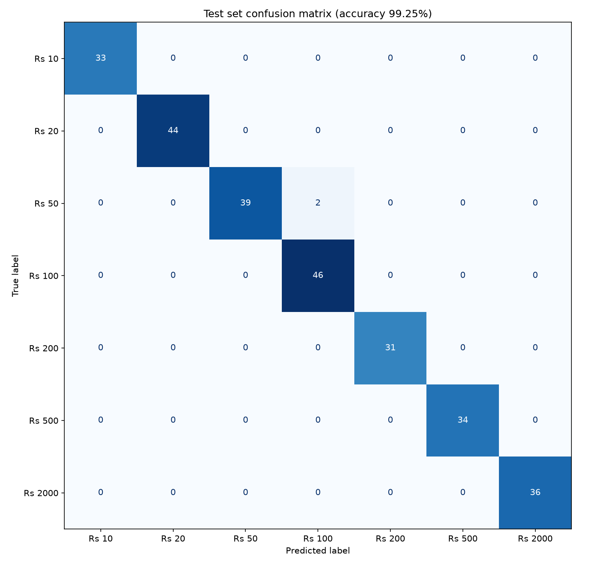
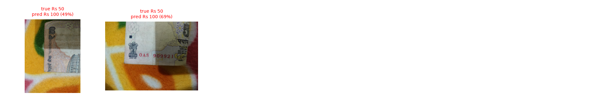
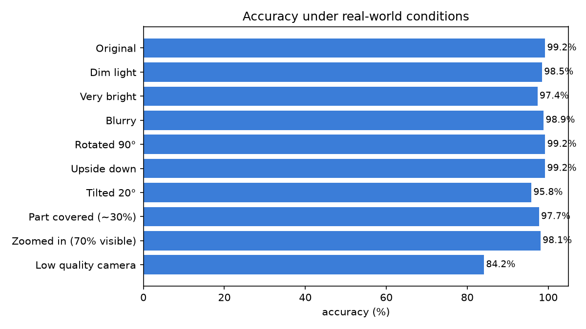

# Evaluation results

Model: `mobilenet_v3_large`, classes: Rs 10, Rs 20, Rs 50, Rs 100, Rs 200, Rs 500, Rs 2000

## 1. Test set (unseen photos from the dataset)

- Photos: **265**
- Accuracy: **99.25%**
- With the confidence check: answers **94.0%** of photos, correct on **100.00%** of those

```
              precision    recall  f1-score   support

       Rs 10     1.0000    1.0000    1.0000        33
       Rs 20     1.0000    1.0000    1.0000        44
       Rs 50     1.0000    0.9512    0.9750        41
      Rs 100     0.9583    1.0000    0.9787        46
      Rs 200     1.0000    1.0000    1.0000        31
      Rs 500     1.0000    1.0000    1.0000        34
     Rs 2000     1.0000    1.0000    1.0000        36

    accuracy                         0.9925       265
   macro avg     0.9940    0.9930    0.9934       265
weighted avg     0.9928    0.9925    0.9924       265

```



Mistakes the model made: 

## 2. Robustness to real-world conditions

Each test photo was changed to imitate a difficult situation, then classified again.

| Condition | Accuracy |
|---|---|
| Original | 99.25% |
| Dim light | 98.49% |
| Very bright | 97.36% |
| Blurry | 98.87% |
| Rotated 90° | 99.25% |
| Upside down | 99.25% |
| Tilted 20° | 95.85% |
| Part covered (~30%) | 97.74% |
| Zoomed in (70% visible) | 98.11% |
| Low quality camera | 84.15% |



## 3. My own photos (completely new data)

_No photos added yet. Put your own photos in `my_photos/<denomination>/` and run again._
